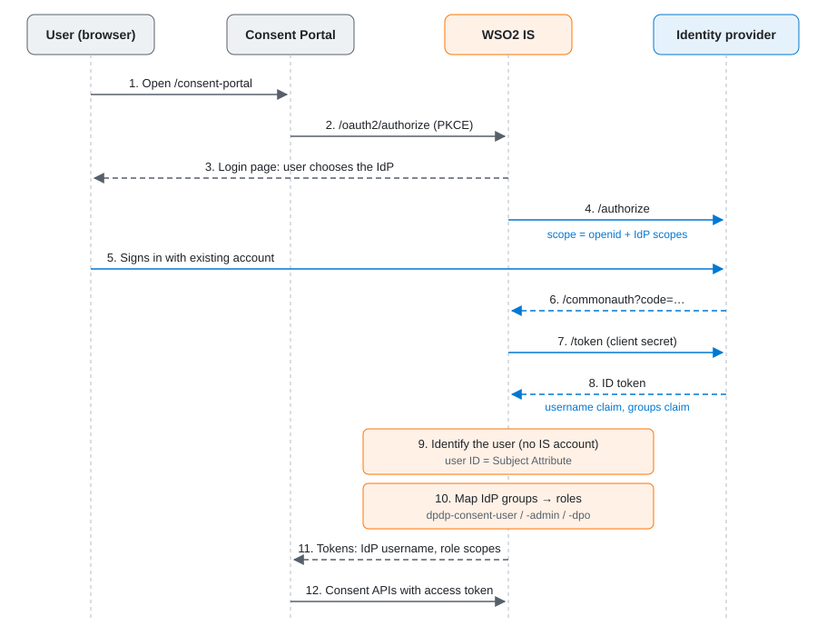

# Federated Login

This section provides an overview of federated login and explains how to configure it for the DPDP Consent Portal.

Federated login allows users who already have accounts with an external identity provider, such as Microsoft Entra ID or Asgardeo, to sign in to the DPDP Consent Portal using their existing credentials, without needing a separate account in WSO2 Identity Server.
Once federated login is configured, these users can use the DPDP solution to manage their consents, file complaints with Data Protection Officers, and receive event notifications related to their consent activities.

## Why use federated login?

- **Simplified sign-in.** Users can sign in with their existing accounts. The identity provider continues to enforce its own authentication policies, including multi-factor authentication (MFA), where configured.
- **Data minimization.** WSO2 Identity Server does not store users' identity provider passwords.  Consent records are associated with the username provided by the identity provider.
- **Centralized role management.** User groups in the identity provider determine whether users can access the Consent Portal as Data Principals, consent administrators, or Data Protection Officers. This lets you manage group membership at the identity provider and map those groups to DPDP roles.
- **Standards-based integration.** The integration uses OpenID Connect (OIDC) and standard token claims, without requiring custom integration code on either side.

## How federated login works

The federated sign-in flow involves the Consent Portal, WSO2 Identity Server, and the external identity provider.

1. A user opens the Consent Portal and selects the configured identity provider as their sign-in option.
2. WSO2 Identity Server redirects the user's browser to the identity provider.
3. The user authenticates with the identity provider, which applies its configured authentication policies and returns an ID token to WSO2 Identity Server.
4. WSO2 Identity Server extracts the user's username and group memberships from the ID token, then maps the groups to the corresponding DPDP roles.
5. WSO2 Identity Server issues an access token for the Consent Portal. The token contains the scopes associated with the user's assigned DPDP roles.

<figure className="doc-figure doc-figure--diagram">

  <figcaption>Figure 1. Federated sign-in flow. This flow applies to all supported identity providers.</figcaption>
</figure>

The following table summarizes the responsibilities of each component.

| Component                                      | Responsibility                                                                                                                                                                                                |
| :--------------------------------------------- | :------------------------------------------------------------------------------------------------------------------------------------------------------------------------------------------------------------ |
| Identity provider                              | Authenticates users, enforces its configured sign-in policies, and issues an ID token containing the user's username and group memberships.                                                                   |
| WSO2 Identity Server with the DPDP Accelerator | Handles federated authentication, maps identity provider groups to DPDP roles, issues access tokens for the Consent Portal, and manages consent records, consent history, and complaints.                     |
| Consent Portal                                 | Provides the browser-based interface through which Data Principals and administrators manage consents and complaints. It acts as an OpenID Connect public client and uses Proof Key for Code Exchange (PKCE). |

## What you need to configure

The overall setup is the same for every supported identity provider, although configurations such as endpoint URLs and claim names may differ.

### In the identity provider

1. Register WSO2 Identity Server as an OpenID Connect application. Configure the following redirect URI, replacing the placeholders with your deployment details:

   `https://<IS_HOST>/commonauth`

2. Obtain the application's client ID and client secret, and record the identity provider's endpoint URLs.

3. Configure the ID token to include a stable username claim and the user's group memberships.

4. Create a group for each DPDP role and assign users to the appropriate groups.

### In WSO2 Identity Server

1. Create an OpenID Connect connection to the external identity provider.
2. Map the identity provider's token claims to the corresponding WSO2 Identity Server claims. Set the **Subject Attribute** to the claim that contains the user's username.
3. Register the identity provider's groups in the connection and map them to the corresponding DPDP roles.
4. Configure the identity provider connection as a sign-in option for the DPDP Consent Portal application.

### Map identity provider groups to DPDP roles

Create groups in your identity provider and map them to the DPDP roles in WSO2 Identity Server. The following table shows an example mapping.

| Identity provider group (example) | DPDP role in WSO2 Identity Server | Purpose                                                                         |
| :-------------------------------- | :-------------------------------- | :------------------------------------------------------------------------------ |
| `Users`                           | `dpdp-consent-user`               | Allows Data Principals to manage their own consents and complaints.             |
| `Admins`                          | `dpdp-consent-admin`              | Allows administrators to manage purposes, data elements, and consent oversight. |
| `Data Protection Officers`        | `dpdp-consent-dpo`                | Allows Data Protection Officers to handle complaints.                           |

The DPDP Accelerator preconfigures the permissions (scopes) associated with these roles. For details about the permissions available to each role, see [Managing Access](../managing-access.md).

## Important considerations

- **Use a stable username claim.** Consent records are stored against the **Subject Attribute**. If that claim is missing from the ID token, WSO2 Identity Server falls back to `sub`, and existing consents no longer match the user.

- **JIT provisioning is off.** Federated users don't appear under **User Management → Users**. Enable JIT provisioning only if you need local accounts, or a WSO2 Identity Server MFA step such as TOTP or Email OTP.

- **Group changes apply at the next sign-in.** After changing a user's groups, have them sign out and sign in again.

- **Configure each tenant separately.** Each tenant has its own Consent Portal application, roles and connections.

- **Prerequisites.** WSO2 Identity Server 7.3.0 at update level 17 or later, reachable by users over HTTPS and able to reach the identity provider.

## Next Steps

Choose the guide for the identity provider you want to integrate with the DPDP Consent Portal:

- [Add Microsoft Entra ID Login](entra-id.md) — let users sign in with their Microsoft Entra ID accounts.
- [Add Asgardeo Login](asgardeo.md) — let users sign in with their Asgardeo accounts.
- [Managing Access](../managing-access.md) — the DPDP roles and the permissions each one grants.
